# Demo results

Produced by `python experiments/run_demos.py` on a 4-core CPU without GPU (the numbers are from one seed; timings are of the sequential simulation).

| demo | command | test acc | other | rounds | communication | wall clock |
|---|---|---|---|---|---|---|
| fedavg_mnist_iid | `python experiments/fedavg.py --config experiments/configs/fedavg_mnist_iid.yaml` | 0.9862 |  | 20 | 169.39 MB | 79.74 s |
| fedavg_mnist_dirichlet | `python experiments/fedavg.py --config experiments/configs/fedavg_mnist_dirichlet.yaml` | 0.9621 |  | 20 | 169.39 MB | 84.03 s |
| fedsgd_mnist | `python experiments/fedavg.py --config experiments/configs/fedsgd_mnist.yaml` | 0.9250 |  | 200 | 3.19 GB | 12.42 s |
| fedavg_cifar10 | `python experiments/fedavg.py --config experiments/configs/fedavg_cifar10.yaml` | 0.5110 |  | 30 | 328.50 MB | 3.9 min |
| byz_ipm_mean | `python experiments/byzantine.py --config experiments/configs/byz_ipm_mean.yaml` | 0.0958 |  | 20 | 701.22 MB | 8.91 s |
| byz_alie_trmean_nnm | `python experiments/byzantine.py --config experiments/configs/byz_alie_mnist.yaml` | 0.9185 |  | 20 | 701.22 MB | 11.08 s |
| byz_ipm_fltrust | `python experiments/byzantine.py --config experiments/configs/byz_fltrust_mnist.yaml` | 0.9253 |  | 20 | 733.09 MB | 10.02 s |
| byz_labelflip_median | `python experiments/byzantine.py --config experiments/configs/byz_labelflip_mnist.yaml` | 0.9231 |  | 20 | 637.47 MB | 10.70 s |
| byz_backdoor_mean | `python experiments/byzantine.py --config experiments/configs/byz_backdoor_mnist.yaml` | 0.9295 | backdoor_asr=0.998 | 20 | 330.69 MB | 6.23 s |
| byz_backdoor_clipping | `python experiments/byzantine.py --config experiments/configs/byz_backdoor_mnist.yaml --set name=byz_backdoor_clipping pre_aggregators=[{name: clipping, c: 0.5}]` | 0.9229 | backdoor_asr=0.342 | 20 | 330.69 MB | 5.64 s |
| dp_none_mnist | `python experiments/dp_fedavg.py --config experiments/configs/dp_central_mnist.yaml --set name=dp_none_mnist dp.noise_multiplier=0.0` | 0.9195 | epsilon=inf | 40 | 125.60 MB | 12.61 s |
| dp_central_mnist | `python experiments/dp_fedavg.py --config experiments/configs/dp_central_mnist.yaml` | 0.8831 | epsilon=4.363 | 40 | 125.60 MB | 13.36 s |
| dp_local_mnist | `python experiments/dp_fedavg.py --config experiments/configs/dp_local_mnist.yaml` | 0.7603 | epsilon=82.127 | 40 | 125.60 MB | 12.91 s |
| secagg_mnist | `python experiments/secure_aggregation.py --config experiments/configs/secagg_mnist.yaml` | 0.9844 | secagg_max_error=2.9e-07 | 15 | 72.84 MB | 51.50 s |
| secaggplus_mnist | `python experiments/secure_aggregation.py --config experiments/configs/secaggplus_mnist.yaml` | 0.9844 | secagg_max_error=2.9e-07 | 15 | 71.54 MB | 47.73 s |
| lightsecagg_mnist | `python experiments/secure_aggregation.py --config experiments/configs/lightsecagg_mnist.yaml` | 0.9844 | secagg_max_error=2.9e-07 | 15 | 210.74 MB | 52.48 s |
| secagg_dp_mnist | `python experiments/secure_aggregation.py --config experiments/configs/secagg_dp_mnist.yaml` | 0.8773 | epsilon=8.939, secagg_max_error=1.6e-07 | 30 | 44.45 MB | 21.92 s |
| secagg_scaling | `python experiments/secagg_scaling.py --config experiments/configs/secagg_scaling.yaml` |  |  |  |  | 32.87 s |
| privacy_attacks_mnist | `python experiments/privacy_attacks.py --config experiments/configs/privacy_attacks_mnist.yaml` |  |  |  | 537.04 kB | 34.88 s |
| sweep_byzantine_mnist | `python experiments/sweep.py --config experiments/configs/sweep_byzantine_mnist.yaml` |  |  |  |  | 7.6 min |
| sweep_byzantine_noniid_mnist | `python experiments/sweep.py --config experiments/configs/sweep_byzantine_noniid_mnist.yaml` |  |  |  |  | 5.5 min |
| sweep_byzantine_noniid_nnm_mnist | `python experiments/sweep.py --config experiments/configs/sweep_byzantine_noniid_nnm_mnist.yaml` |  |  |  |  | 6.1 min |
| lightsecagg_mnist_dropouts | `python experiments/secure_aggregation.py --config experiments/configs/lightsecagg_mnist_dropouts.yaml` | 0.9849 | secagg_max_error=2.8e-07 | 15 | 243.87 MB | 62.95 s |
| privacy_attacks_mnist_central | `python experiments/privacy_attacks.py --config experiments/configs/privacy_attacks_mnist.yaml --set name=privacy_attacks_mnist_central privacy.dp_mode=central` |  |  |  | 537.04 kB | 32.44 s |

## fedavg_mnist_iid

folder: `fedavg_mnist_iid/20261104-171824`

<details><summary>report.txt</summary>

```
EXPERIMENT  fedavg_mnist_iid
output      demo_results/fedavg_mnist_iid/20261104-171824
device      cpu (4 threads)
wall clock  78.20 s (sequential simulation)

FINAL METRICS (last evaluated round)
  round            20
  test_loss        0.0420
  test_acc         0.9862
  elapsed_s        77.4531

COMMUNICATION   (total 169.39 MB over 20 round(s))
label                   direction       msgs  total     per round  per msg  
----------------------------------------------------------------------------
download: global model  server->client   200  84.69 MB    4.23 MB  423.46 kB
upload: model           client->server   200  84.69 MB    4.23 MB  423.46 kB

COMPUTATION   ('avg/round' = average over parties, 'parallel/round' = max over parties = concurrent clients)
label                 who     calls  total    per call  avg/round  parallel/round
---------------------------------------------------------------------------------
client: local update  client    200  63.46 s  317.3 ms   317.3 ms        363.3 ms
server: aggregate     server     20  30.7 ms    1.5 ms     1.5 ms          1.5 ms
server: evaluate      server     20  12.53 s  626.3 ms   626.3 ms        626.3 ms

ESTIMATED ROUND LATENCY with concurrent clients (uplink 10 Mbit/s, downlink 50 Mbit/s): compute 991.1 ms + communication 406.5 ms = 1.40 s per round

figures: convergence.png, communication.png, computation.png
```

</details>

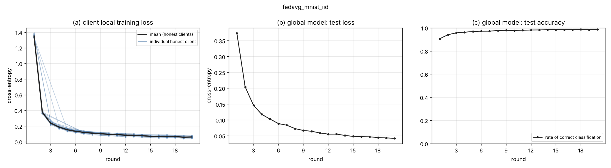

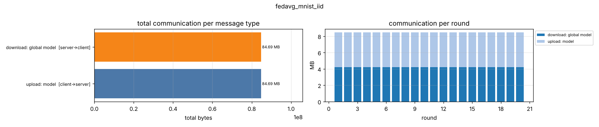
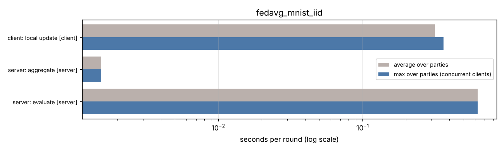

## fedavg_mnist_dirichlet

folder: `fedavg_mnist_dirichlet/20261104-171943`

<details><summary>report.txt</summary>

```
EXPERIMENT  fedavg_mnist_dirichlet
output      demo_results/fedavg_mnist_dirichlet/20261104-171943
device      cpu (4 threads)
wall clock  84.02 s (sequential simulation)

FINAL METRICS (last evaluated round)
  round            20
  test_loss        0.1240
  test_acc         0.9621
  elapsed_s        83.3142

COMMUNICATION   (total 169.39 MB over 20 round(s))
label                   direction       msgs  total     per round  per msg  
----------------------------------------------------------------------------
download: global model  server->client   200  84.69 MB    4.23 MB  423.46 kB
upload: model           client->server   200  84.69 MB    4.23 MB  423.46 kB

COMPUTATION   ('avg/round' = average over parties, 'parallel/round' = max over parties = concurrent clients)
label                 who     calls  total    per call  avg/round  parallel/round
---------------------------------------------------------------------------------
client: local update  client    200  69.58 s  347.9 ms   347.9 ms        569.3 ms
server: aggregate     server     20  13.5 ms    673 us     673 us          673 us
server: evaluate      server     20  13.31 s  665.5 ms   665.5 ms        665.5 ms

ESTIMATED ROUND LATENCY with concurrent clients (uplink 10 Mbit/s, downlink 50 Mbit/s): compute 1.24 s + communication 406.5 ms = 1.64 s per round

figures: convergence.png, communication.png, computation.png
```

</details>

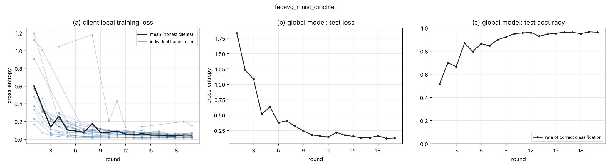
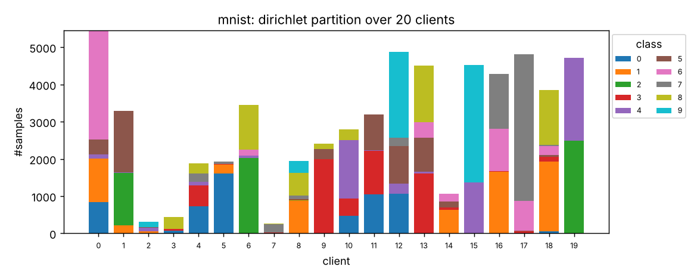

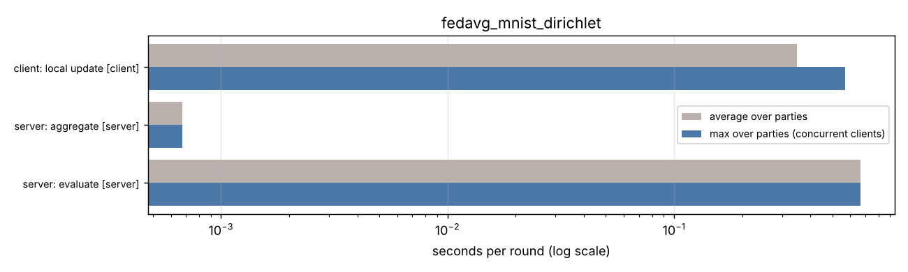

## fedsgd_mnist

folder: `fedsgd_mnist/20261104-172107`

<details><summary>report.txt</summary>

```
EXPERIMENT  fedsgd_mnist
output      demo_results/fedsgd_mnist/20261104-172107
device      cpu (4 threads)
wall clock  12.37 s (sequential simulation)

FINAL METRICS (last evaluated round)
  round            200
  test_loss        0.2546
  test_acc         0.9250
  elapsed_s        11.0429

COMMUNICATION   (total 3.19 GB over 200 round(s))
label                   direction       msgs  total    per round  per msg  
---------------------------------------------------------------------------
download: global model  server->client  2000  1.59 GB    7.97 MB  796.84 kB
upload: gradient        client->server  2000  1.59 GB    7.97 MB  796.84 kB

COMPUTATION   ('avg/round' = average over parties, 'parallel/round' = max over parties = concurrent clients)
label                 who     calls  total     per call  avg/round  parallel/round
----------------------------------------------------------------------------------
client: local update  client   2000    8.32 s    4.2 ms     4.2 ms          6.3 ms
server: aggregate     server    200  736.1 ms    3.7 ms     3.7 ms          3.7 ms
server: evaluate      server     20    1.48 s   74.2 ms    74.2 ms         74.2 ms

ESTIMATED ROUND LATENCY with concurrent clients (uplink 10 Mbit/s, downlink 50 Mbit/s): compute 17.4 ms + communication 765.0 ms = 782.4 ms per round

figures: convergence.png, communication.png, computation.png
```

</details>

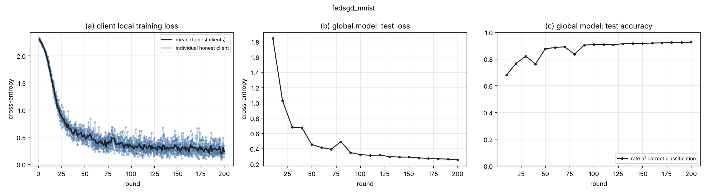


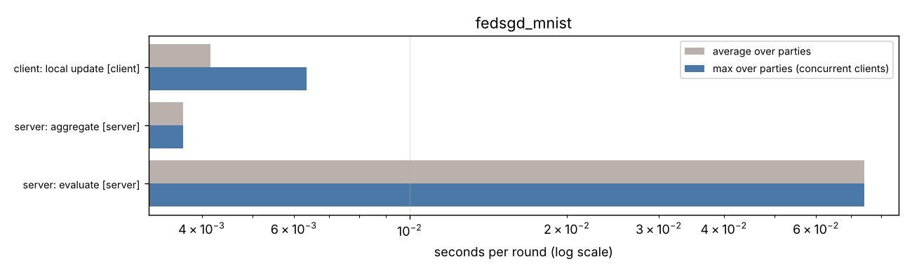

## fedavg_cifar10

folder: `fedavg_cifar10/20261104-175008`

<details><summary>report.txt</summary>

```
EXPERIMENT  fedavg_cifar10
output      demo_results/fedavg_cifar10/20261104-175008
device      cpu (4 threads)
wall clock  3.8 min (sequential simulation)

FINAL METRICS (last evaluated round)
  round            30
  test_loss        1.4939
  test_acc         0.5110
  elapsed_s        229.2843

COMMUNICATION   (total 328.50 MB over 30 round(s))
label                   direction       msgs  total      per round  per msg  
-----------------------------------------------------------------------------
download: global model  server->client   300  164.25 MB    5.47 MB  547.50 kB
upload: model           client->server   300  164.25 MB    5.47 MB  547.50 kB

COMPUTATION   ('avg/round' = average over parties, 'parallel/round' = max over parties = concurrent clients)
label                 who     calls  total    per call  avg/round  parallel/round
---------------------------------------------------------------------------------
client: local update  client    300  3.3 min  659.6 ms   659.6 ms        997.6 ms
server: aggregate     server     30  23.2 ms    774 us     774 us          774 us
server: evaluate      server     30  27.44 s  914.8 ms   914.8 ms        914.8 ms

ESTIMATED ROUND LATENCY with concurrent clients (uplink 10 Mbit/s, downlink 50 Mbit/s): compute 1.91 s + communication 525.6 ms = 2.44 s per round

figures: convergence.png, communication.png, computation.png
```

</details>

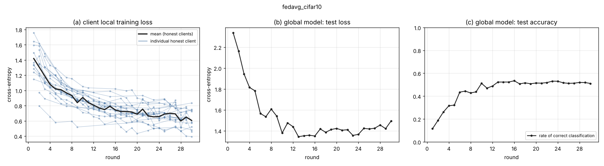
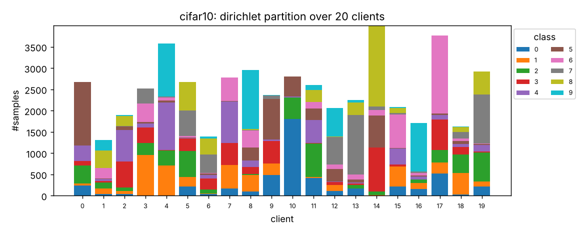
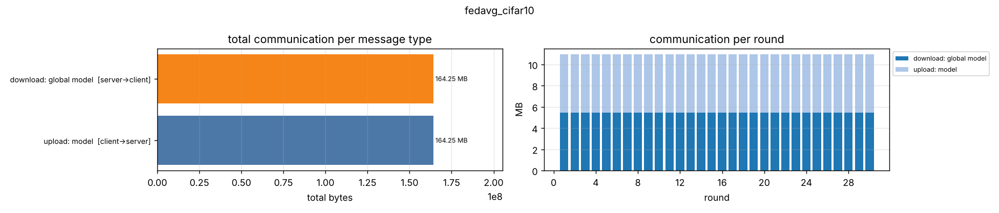
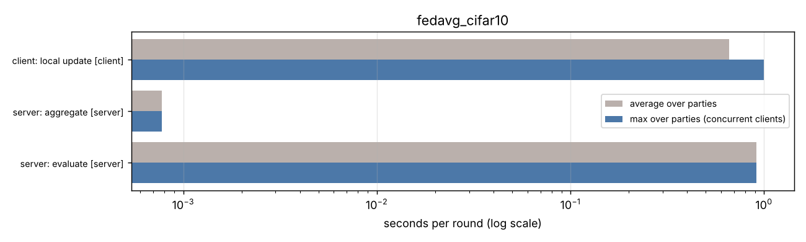

## byz_ipm_mean

folder: `byz_ipm_mean/20261104-172620`

<details><summary>report.txt</summary>

```
EXPERIMENT  byz_ipm_mean
output      demo_results/byz_ipm_mean/20261104-172620
device      cpu (4 threads)
wall clock  8.90 s (sequential simulation)

FINAL METRICS (last evaluated round)
  round            20
  test_loss        328.2845
  test_acc         0.0958
  deviation        7.5041
  elapsed_s        8.2003

attack: InnerProductManipulation(tau=5.0)
data_attack: None
aggregator: Average()
pre_aggregators: []
byzantine: [9, 11, 14, 16]

COMMUNICATION   (total 701.22 MB over 20 round(s))
label                   direction          msgs  total      per round  per msg  
--------------------------------------------------------------------------------
collusion/vector        client->colluders    80   63.75 MB    3.19 MB  796.84 kB
download: global model     server->client   400  318.74 MB   15.94 MB  796.84 kB
upload: delta              client->server   400  318.74 MB   15.94 MB  796.84 kB

COMPUTATION   ('avg/round' = average over parties, 'parallel/round' = max over parties = concurrent clients)
label                           who     calls  total     per call  avg/round  parallel/round
--------------------------------------------------------------------------------------------
attack: craft byzantine vector  client     20   12.2 ms    611 us     611 us          611 us
client: local update            client    400    7.24 s   18.1 ms    18.1 ms         24.1 ms
server: aggregate               server     20   41.6 ms    2.1 ms     2.1 ms          2.1 ms
server: evaluate                server     20  402.5 ms   20.1 ms    20.1 ms         20.1 ms

ESTIMATED ROUND LATENCY with concurrent clients (uplink 10 Mbit/s, downlink 50 Mbit/s): compute 46.9 ms + communication 1.40 s = 1.45 s per round

figures: convergence.png, communication.png, computation.png
```

</details>

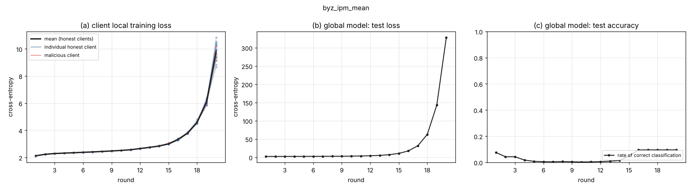

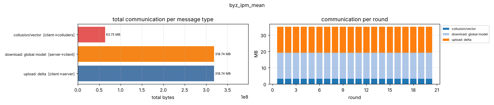
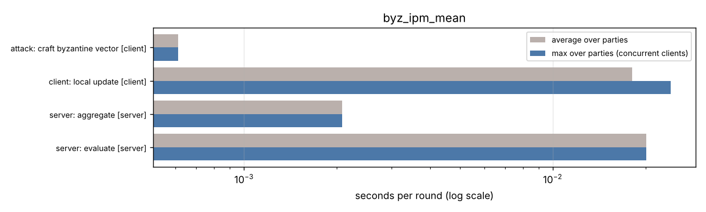

## byz_alie_trmean_nnm

folder: `byz_alie_trmean_nnm/20261104-172629`

<details><summary>report.txt</summary>

```
EXPERIMENT  byz_alie_trmean_nnm
output      demo_results/byz_alie_trmean_nnm/20261104-172629
device      cpu (4 threads)
wall clock  11.06 s (sequential simulation)

FINAL METRICS (last evaluated round)
  round            20
  test_loss        0.2727
  test_acc         0.9185
  deviation        0.0000
  elapsed_s        10.2899

attack: ALittleIsEnough(tau=1.5)
data_attack: None
aggregator: TrimmedMean(f=4)
pre_aggregators: [NNM(f=4)]
byzantine: [9, 11, 14, 16]

COMMUNICATION   (total 701.22 MB over 20 round(s))
label                   direction          msgs  total      per round  per msg  
--------------------------------------------------------------------------------
collusion/vector        client->colluders    80   63.75 MB    3.19 MB  796.84 kB
download: global model     server->client   400  318.74 MB   15.94 MB  796.84 kB
upload: delta              client->server   400  318.74 MB   15.94 MB  796.84 kB

COMPUTATION   ('avg/round' = average over parties, 'parallel/round' = max over parties = concurrent clients)
label                           who     calls  total     per call  avg/round  parallel/round
--------------------------------------------------------------------------------------------
attack: craft byzantine vector  client     20  615.3 ms   30.8 ms    30.8 ms         30.8 ms
client: local update            client    400    7.40 s   18.5 ms    18.5 ms         24.5 ms
server: aggregate               server     20    1.39 s   69.3 ms    69.3 ms         69.3 ms
server: evaluate                server     20  417.0 ms   20.8 ms    20.8 ms         20.8 ms

ESTIMATED ROUND LATENCY with concurrent clients (uplink 10 Mbit/s, downlink 50 Mbit/s): compute 145.4 ms + communication 1.40 s = 1.55 s per round

figures: convergence.png, communication.png, computation.png
```

</details>

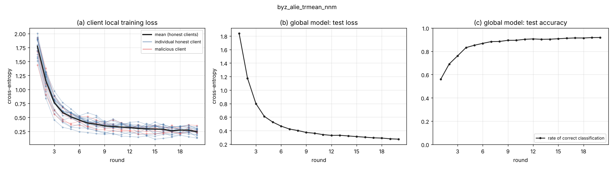
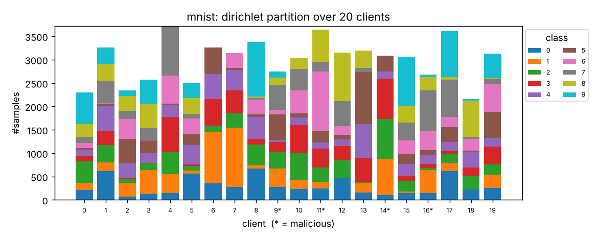

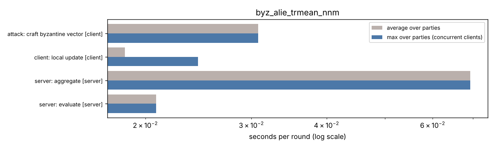

## byz_ipm_fltrust

folder: `byz_ipm_fltrust/20261104-172640`

<details><summary>report.txt</summary>

```
EXPERIMENT  byz_ipm_fltrust
output      demo_results/byz_ipm_fltrust/20261104-172640
device      cpu (4 threads)
wall clock  10.01 s (sequential simulation)

FINAL METRICS (last evaluated round)
  round            20
  test_loss        0.2374
  test_acc         0.9253
  deviation        0.1525
  elapsed_s        9.2198

attack: InnerProductManipulation(tau=5.0)
data_attack: None
aggregator: FLTrust()
pre_aggregators: []
byzantine: [3, 8, 10, 12, 14, 19]

COMMUNICATION   (total 733.09 MB over 20 round(s))
label                   direction          msgs  total      per round  per msg  
--------------------------------------------------------------------------------
collusion/vector        client->colluders   120   95.62 MB    4.78 MB  796.84 kB
download: global model     server->client   400  318.74 MB   15.94 MB  796.84 kB
upload: delta              client->server   400  318.74 MB   15.94 MB  796.84 kB

COMPUTATION   ('avg/round' = average over parties, 'parallel/round' = max over parties = concurrent clients)
label                           who     calls  total     per call  avg/round  parallel/round
--------------------------------------------------------------------------------------------
attack: craft byzantine vector  client     20   17.9 ms    893 us     893 us          893 us
client: local update            client    400    7.47 s   18.7 ms    18.7 ms         29.1 ms
server: aggregate               server     20  277.0 ms   13.9 ms    13.9 ms         13.9 ms
server: evaluate                server     20  431.8 ms   21.6 ms    21.6 ms         21.6 ms
server: root update (FLTrust)   server     20  367.7 ms   18.4 ms    18.4 ms         18.4 ms

ESTIMATED ROUND LATENCY with concurrent clients (uplink 10 Mbit/s, downlink 50 Mbit/s): compute 83.8 ms + communication 1.40 s = 1.49 s per round

figures: convergence.png, communication.png, computation.png
```

</details>

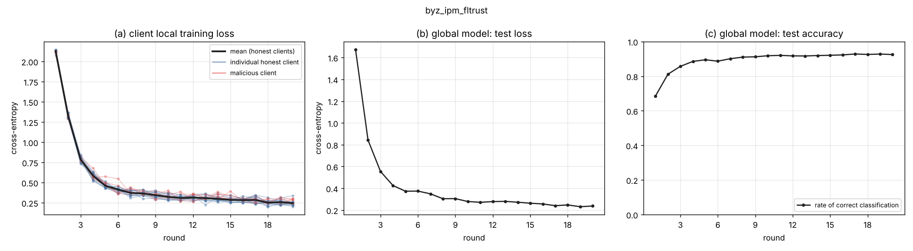
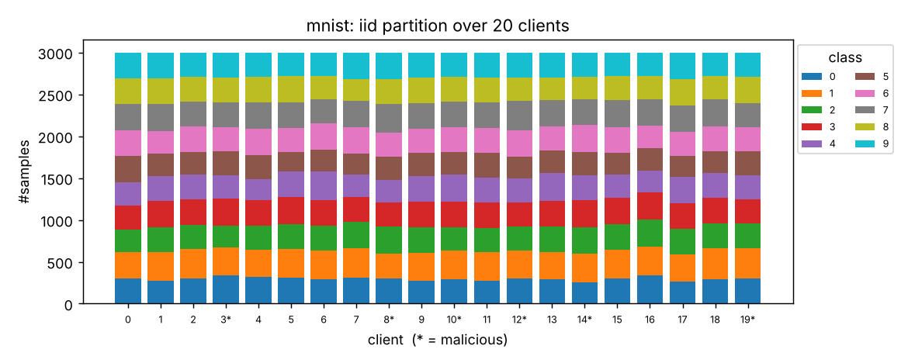
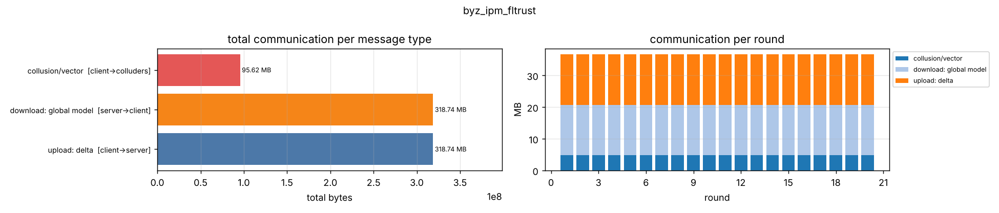
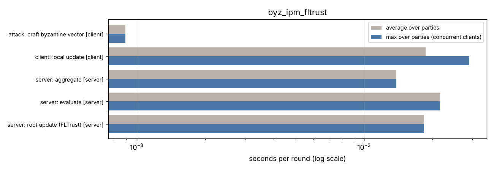

## byz_labelflip_median

folder: `byz_labelflip_median/20261104-172650`

<details><summary>report.txt</summary>

```
EXPERIMENT  byz_labelflip_median
output      demo_results/byz_labelflip_median/20261104-172650
device      cpu (4 threads)
wall clock  10.68 s (sequential simulation)

FINAL METRICS (last evaluated round)
  round            20
  test_loss        0.2741
  test_acc         0.9231
  deviation        0.1510
  elapsed_s        9.7094

attack: None
data_attack: label_flip
aggregator: Median()
pre_aggregators: []
byzantine: [3, 8, 10, 12, 14, 19]

COMMUNICATION   (total 637.47 MB over 20 round(s))
label                   direction       msgs  total      per round  per msg  
-----------------------------------------------------------------------------
download: global model  server->client   400  318.74 MB   15.94 MB  796.84 kB
upload: delta           client->server   400  318.74 MB   15.94 MB  796.84 kB

COMPUTATION   ('avg/round' = average over parties, 'parallel/round' = max over parties = concurrent clients)
label                 who     calls  total     per call  avg/round  parallel/round
----------------------------------------------------------------------------------
client: local update  client    400    7.67 s   19.2 ms    19.2 ms         29.3 ms
server: aggregate     server     20  621.3 ms   31.1 ms    31.1 ms         31.1 ms
server: evaluate      server     20  398.7 ms   19.9 ms    19.9 ms         19.9 ms

ESTIMATED ROUND LATENCY with concurrent clients (uplink 10 Mbit/s, downlink 50 Mbit/s): compute 80.3 ms + communication 765.0 ms = 845.3 ms per round

figures: convergence.png, communication.png, computation.png
```

</details>

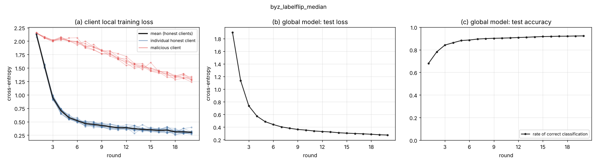


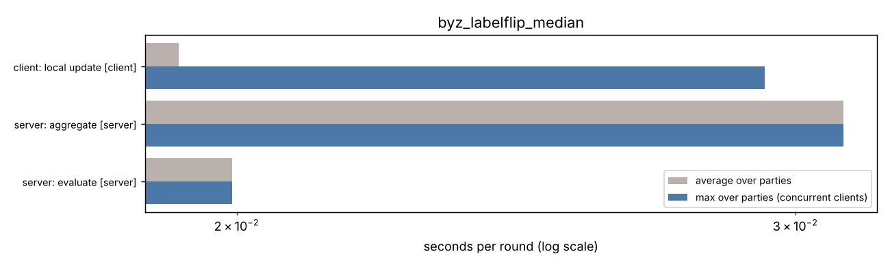

## byz_backdoor_mean

folder: `byz_backdoor_mean/20261104-172701`

<details><summary>report.txt</summary>

```
EXPERIMENT  byz_backdoor_mean
output      demo_results/byz_backdoor_mean/20261104-172701
device      cpu (4 threads)
wall clock  6.22 s (sequential simulation)

FINAL METRICS (last evaluated round)
  round            20
  test_loss        0.2415
  test_acc         0.9295
  deviation        0.0000
  backdoor_asr     0.9976
  elapsed_s        5.4514

attack: Scaling(factor=5.0)
data_attack: backdoor
aggregator: Average()
pre_aggregators: []
byzantine: [10, 18]

COMMUNICATION   (total 330.69 MB over 20 round(s))
label                   direction          msgs  total      per round  per msg  
--------------------------------------------------------------------------------
collusion/vector        client->colluders    15   11.95 MB  919.43 kB  796.84 kB
download: global model     server->client   200  159.37 MB    7.97 MB  796.84 kB
upload: delta              client->server   200  159.37 MB    7.97 MB  796.84 kB

COMPUTATION   ('avg/round' = average over parties, 'parallel/round' = max over parties = concurrent clients)
label                           who     calls  total     per call  avg/round  parallel/round
--------------------------------------------------------------------------------------------
attack: craft byzantine vector  client     13    4.1 ms    312 us     312 us          312 us
client: local update            client    200    4.15 s   20.8 ms    20.8 ms         30.0 ms
server: aggregate               server     20   32.6 ms    1.6 ms     1.6 ms          1.6 ms
server: evaluate                server     20  833.2 ms   41.7 ms    41.7 ms         41.7 ms

ESTIMATED ROUND LATENCY with concurrent clients (uplink 10 Mbit/s, downlink 50 Mbit/s): compute 73.5 ms + communication 1.18 s = 1.25 s per round

figures: convergence.png, communication.png, computation.png
```

</details>

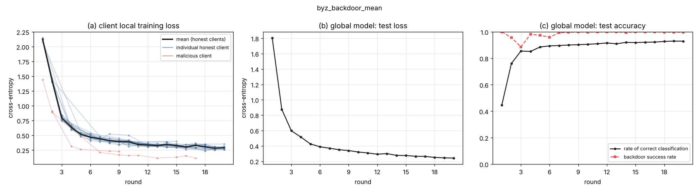


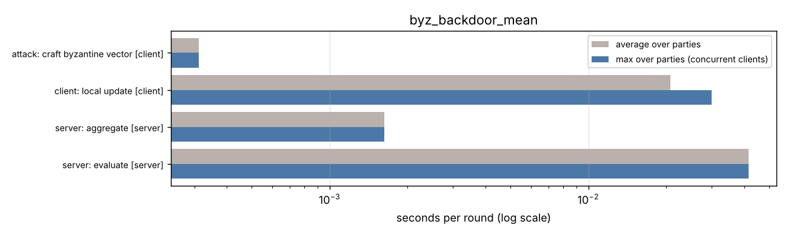

## byz_backdoor_clipping

folder: `byz_backdoor_clipping/20261104-172707`

<details><summary>report.txt</summary>

```
EXPERIMENT  byz_backdoor_clipping
output      demo_results/byz_backdoor_clipping/20261104-172707
device      cpu (4 threads)
wall clock  5.63 s (sequential simulation)

FINAL METRICS (last evaluated round)
  round            20
  test_loss        0.2630
  test_acc         0.9229
  deviation        0.0000
  backdoor_asr     0.3424
  elapsed_s        4.8210

attack: Scaling(factor=5.0)
data_attack: backdoor
aggregator: Average()
pre_aggregators: [Clipping(c=0.5)]
byzantine: [10, 18]

COMMUNICATION   (total 330.69 MB over 20 round(s))
label                   direction          msgs  total      per round  per msg  
--------------------------------------------------------------------------------
collusion/vector        client->colluders    15   11.95 MB  919.43 kB  796.84 kB
download: global model     server->client   200  159.37 MB    7.97 MB  796.84 kB
upload: delta              client->server   200  159.37 MB    7.97 MB  796.84 kB

COMPUTATION   ('avg/round' = average over parties, 'parallel/round' = max over parties = concurrent clients)
label                           who     calls  total     per call  avg/round  parallel/round
--------------------------------------------------------------------------------------------
attack: craft byzantine vector  client     13    6.3 ms    481 us     481 us          481 us
client: local update            client    200    3.59 s   18.0 ms    18.0 ms         22.5 ms
server: aggregate               server     20   52.2 ms    2.6 ms     2.6 ms          2.6 ms
server: evaluate                server     20  779.8 ms   39.0 ms    39.0 ms         39.0 ms

ESTIMATED ROUND LATENCY with concurrent clients (uplink 10 Mbit/s, downlink 50 Mbit/s): compute 64.4 ms + communication 1.18 s = 1.24 s per round

figures: convergence.png, communication.png, computation.png
```

</details>

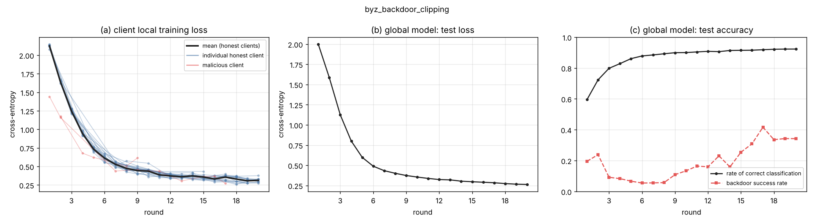

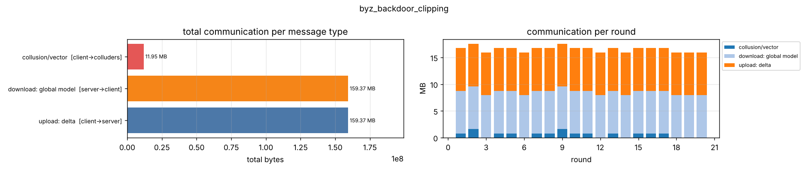
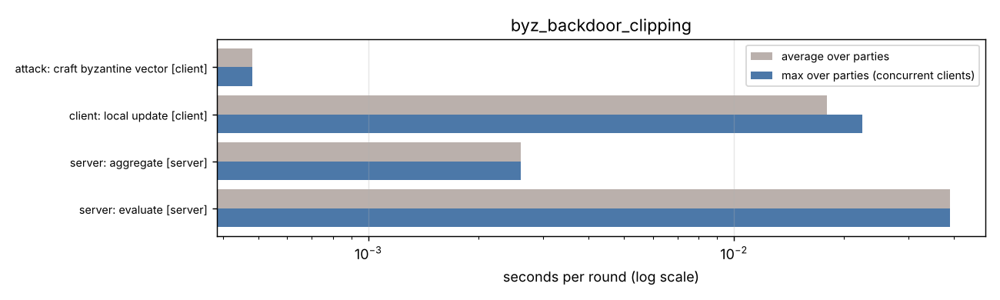

## dp_none_mnist

folder: `dp_none_mnist/20261104-172713`

<details><summary>report.txt</summary>

```
EXPERIMENT  dp_none_mnist
output      demo_results/dp_none_mnist/20261104-172713
device      cpu (4 threads)
wall clock  12.54 s (sequential simulation)

FINAL METRICS (last evaluated round)
  round            40
  test_loss        0.2885
  test_acc         0.9195
  epsilon          inf
  elapsed_s        11.5924

epsilon: inf
dp_mode: central

DP: mode=central, C=0.5, sigma=0.0, delta=1e-05, cohort m=50 of N=200 (q=0.250)
final epsilon = inf  ((inf, 1e-05)-DP at the client level)
client update norms before clipping: median 0.561, 90th percentile 0.838  -> fraction clipped 0.75

COMMUNICATION   (total 125.60 MB over 40 round(s))
label                   direction       msgs  total     per round  per msg 
---------------------------------------------------------------------------
download: global model  server->client  2000  62.80 MB    1.57 MB  31.40 kB
upload: delta           client->server  2000  62.80 MB    1.57 MB  31.40 kB

COMPUTATION   ('avg/round' = average over parties, 'parallel/round' = max over parties = concurrent clients)
label                 who     calls  total     per call  avg/round  parallel/round
----------------------------------------------------------------------------------
client: DP            client   2000  102.7 ms     51 us      51 us          114 us
client: local update  client   2000    8.60 s    4.3 ms     4.3 ms          9.3 ms
server: aggregate     server     40   28.4 ms    711 us     711 us          711 us
server: evaluate      server     40  365.9 ms    9.1 ms     9.1 ms          9.1 ms

ESTIMATED ROUND LATENCY with concurrent clients (uplink 10 Mbit/s, downlink 50 Mbit/s): compute 19.2 ms + communication 30.1 ms = 49.4 ms per round

figures: convergence.png, communication.png, computation.png
```

</details>

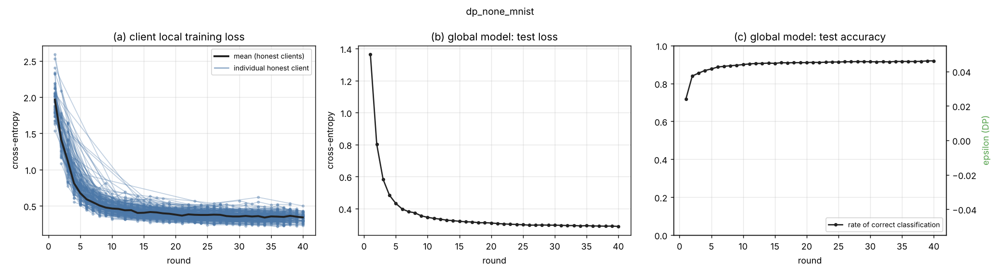
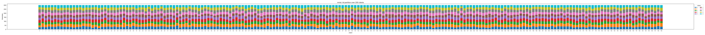

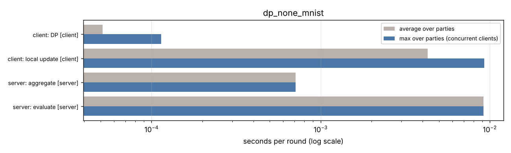

## dp_central_mnist

folder: `dp_central_mnist/20261104-172725`

<details><summary>report.txt</summary>

```
EXPERIMENT  dp_central_mnist
output      demo_results/dp_central_mnist/20261104-172725
device      cpu (4 threads)
wall clock  13.29 s (sequential simulation)

FINAL METRICS (last evaluated round)
  round            40
  test_loss        0.4266
  test_acc         0.8831
  epsilon          4.3633
  elapsed_s        12.4078

epsilon: 4.363317006527225
dp_mode: central

DP: mode=central, C=0.5, sigma=2.0, delta=1e-05, cohort m=50 of N=200 (q=0.250)
final epsilon = 4.363  ((4.36, 1e-05)-DP at the client level)
client update norms before clipping: median 0.646, 90th percentile 0.911  -> fraction clipped 0.97

COMMUNICATION   (total 125.60 MB over 40 round(s))
label                   direction       msgs  total     per round  per msg 
---------------------------------------------------------------------------
download: global model  server->client  2000  62.80 MB    1.57 MB  31.40 kB
upload: delta           client->server  2000  62.80 MB    1.57 MB  31.40 kB

COMPUTATION   ('avg/round' = average over parties, 'parallel/round' = max over parties = concurrent clients)
label                 who     calls  total     per call  avg/round  parallel/round
----------------------------------------------------------------------------------
client: DP            client   2000  107.2 ms     54 us      54 us          139 us
client: local update  client   2000    8.63 s    4.3 ms     4.3 ms          9.3 ms
server: aggregate     server     40   34.5 ms    863 us     863 us          863 us
server: evaluate      server     40  416.1 ms   10.4 ms    10.4 ms         10.4 ms

ESTIMATED ROUND LATENCY with concurrent clients (uplink 10 Mbit/s, downlink 50 Mbit/s): compute 20.7 ms + communication 30.1 ms = 50.8 ms per round

figures: convergence.png, communication.png, computation.png
```

</details>

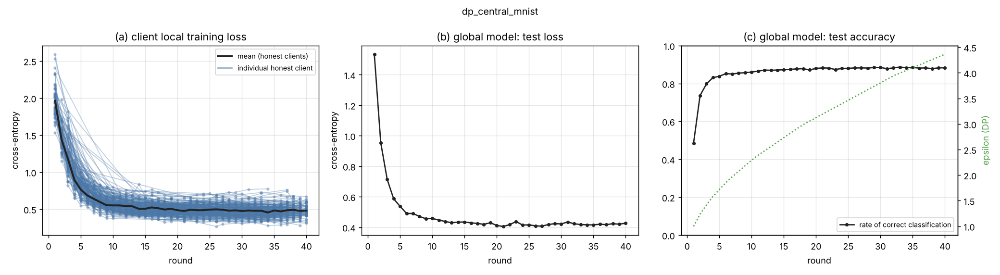

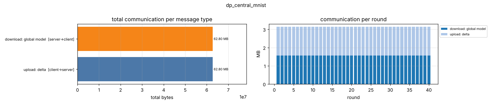
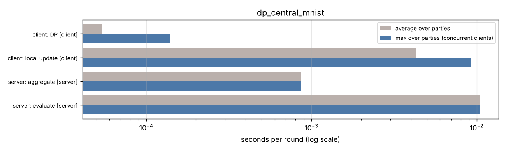

## dp_local_mnist

folder: `dp_local_mnist/20261104-172739`

<details><summary>report.txt</summary>

```
EXPERIMENT  dp_local_mnist
output      demo_results/dp_local_mnist/20261104-172739
device      cpu (4 threads)
wall clock  12.84 s (sequential simulation)

FINAL METRICS (last evaluated round)
  round            40
  test_loss        1.7823
  test_acc         0.7603
  epsilon          82.1266
  elapsed_s        11.8225

epsilon: 82.12663110385034
dp_mode: local

DP: mode=local, C=0.5, sigma=1.0, delta=1e-05, cohort m=50 of N=200 (q=0.250)
final epsilon = 82.127  ((82.13, 1e-05)-DP at the client level, per client (local DP))
client update norms before clipping: median 1.146, 90th percentile 1.461  -> fraction clipped 1.00

COMMUNICATION   (total 125.60 MB over 40 round(s))
label                   direction       msgs  total     per round  per msg 
---------------------------------------------------------------------------
download: global model  server->client  2000  62.80 MB    1.57 MB  31.40 kB
upload: delta           client->server  2000  62.80 MB    1.57 MB  31.40 kB

COMPUTATION   ('avg/round' = average over parties, 'parallel/round' = max over parties = concurrent clients)
label                 who     calls  total     per call  avg/round  parallel/round
----------------------------------------------------------------------------------
client: DP            client   2000  242.2 ms    121 us     121 us          265 us
client: local update  client   2000    8.94 s    4.5 ms     4.5 ms         18.7 ms
server: aggregate     server     40   31.2 ms    780 us     780 us          780 us
server: evaluate      server     40  363.6 ms    9.1 ms     9.1 ms          9.1 ms

ESTIMATED ROUND LATENCY with concurrent clients (uplink 10 Mbit/s, downlink 50 Mbit/s): compute 28.9 ms + communication 30.1 ms = 59.0 ms per round

figures: convergence.png, communication.png, computation.png
```

</details>

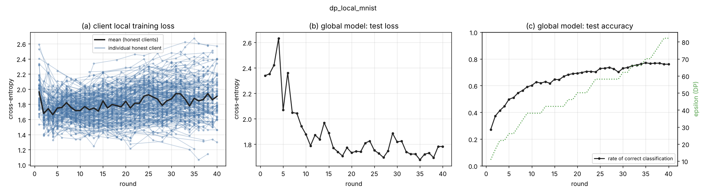


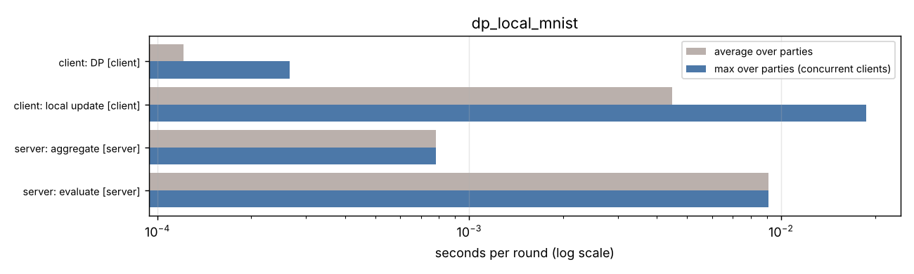

## secagg_mnist

folder: `secagg_mnist/20261104-175358`

<details><summary>report.txt</summary>

```
EXPERIMENT  secagg_mnist
output      demo_results/secagg_mnist/20261104-175358
device      cpu (4 threads)
wall clock  51.46 s (sequential simulation)

FINAL METRICS (last evaluated round)
  round            15
  test_loss        0.0466
  test_acc         0.9844
  survivors        9
  secagg_max_error 0.0000
  elapsed_s        50.3899

protocol: secagg

parameters: SecAgg(SecAggPlusParams(num_shares=1.0, reconstruction_threshold=0.5, max_weight=1.0, clipping_range=1.0, quantization_range=4194304, modulus_range=4294967296))
last round: {'num_shares': 10, 'threshold': 5, 'U1': 10, 'U2': 10, 'U3': 9, 'U4': 9, 'clipped_fraction': 0.0}
max |secure mean - plain mean| over the last round: 2.91e-07 (quantisation step = 4.8e-07)

COMMUNICATION   (total 72.84 MB over 15 round(s))
label                                    direction       msgs  total      per round  per msg  
----------------------------------------------------------------------------------------------
download: global model                   server->client   150   37.02 MB    2.47 MB  246.82 kB
secagg/0 setup: config                   server->client   150   15.00 kB    1.00 kB      100 B
secagg/0 setup: public keys              client->server   150   64.50 kB    4.30 kB      430 B
secagg/1 share keys: encrypted shares    client->server   150  827.55 kB   55.17 kB    5.52 kB
secagg/1 share keys: public keys         server->client   150  646.50 kB   43.10 kB    4.31 kB
secagg/2 masked input: encrypted shares  server->client   150  827.55 kB   55.17 kB    5.52 kB
secagg/2 masked input: masked vector     client->server   135   33.32 MB    2.22 MB  246.83 kB
secagg/3 unmask: secret shares           client->server   135  108.27 kB    7.22 kB      802 B
secagg/3 unmask: survivor lists          server->client   135    1.35 kB       90 B       10 B

COMPUTATION   ('avg/round' = average over parties, 'parallel/round' = max over parties = concurrent clients)
label                           who     calls  total    per call  avg/round  parallel/round
-------------------------------------------------------------------------------------------
client: local update            client    150  38.88 s  259.2 ms   259.2 ms        297.1 ms
secagg/0 setup [client]         client    150  63.5 ms    423 us     423 us          647 us
secagg/0 setup [server]         server     15   808 us     54 us      54 us           54 us
secagg/1 share keys [client]    client    150   2.21 s   14.7 ms    14.7 ms         18.8 ms
secagg/2 masked input [client]  client    135   1.38 s   10.2 ms    10.2 ms         12.0 ms
secagg/2 masked input [server]  server    135  10.9 ms     81 us     726 us          726 us
secagg/3 unmask [client]        client    135   465 us      3 us       3 us            9 us
secagg/3 unmask [server]        server     15   3.46 s  230.6 ms   230.6 ms        230.6 ms
server: evaluate                server     15   3.83 s  255.4 ms   255.4 ms        255.4 ms

ESTIMATED ROUND LATENCY with concurrent clients (uplink 10 Mbit/s, downlink 50 Mbit/s): compute 815.3 ms + communication 243.9 ms = 1.06 s per round

figures: convergence.png, communication.png, computation.png
```

</details>

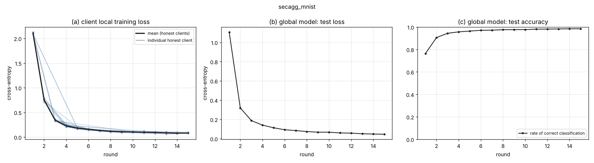

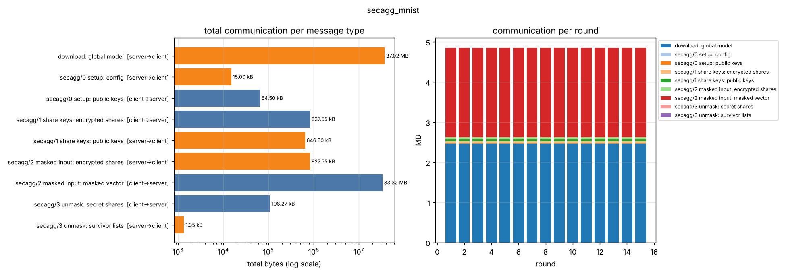
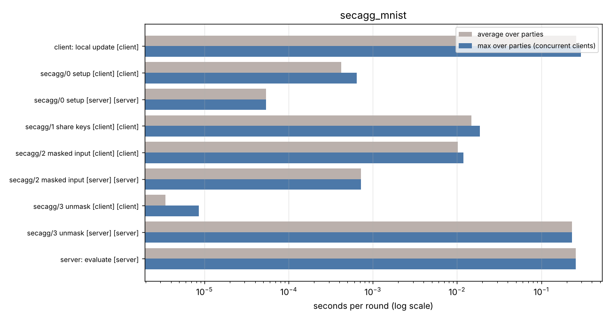

## secaggplus_mnist

folder: `secaggplus_mnist/20261104-175449`

<details><summary>report.txt</summary>

```
EXPERIMENT  secaggplus_mnist
output      demo_results/secaggplus_mnist/20261104-175449
device      cpu (4 threads)
wall clock  47.71 s (sequential simulation)

FINAL METRICS (last evaluated round)
  round            15
  test_loss        0.0466
  test_acc         0.9844
  survivors        9
  secagg_max_error 0.0000
  elapsed_s        46.2858

protocol: secagg+

parameters: SecAggPlus(SecAggPlusParams(num_shares=5, reconstruction_threshold=3, max_weight=1.0, clipping_range=1.0, quantization_range=4194304, modulus_range=4294967296))
last round: {'num_shares': 5, 'threshold': 3, 'U1': 10, 'U2': 10, 'U3': 9, 'U4': 9, 'clipped_fraction': 0.0}
max |secure mean - plain mean| over the last round: 2.91e-07 (quantisation step = 4.8e-07)

COMMUNICATION   (total 71.54 MB over 15 round(s))
label                                     direction       msgs  total      per round  per msg  
-----------------------------------------------------------------------------------------------
download: global model                    server->client   150   37.02 MB    2.47 MB  246.82 kB
secagg+/0 setup: config                   server->client   150   15.00 kB    1.00 kB      100 B
secagg+/0 setup: public keys              client->server   150   64.50 kB    4.30 kB      430 B
secagg+/1 share keys: encrypted shares    client->server   150  367.80 kB   24.52 kB    2.45 kB
secagg+/1 share keys: public keys         server->client   150  323.25 kB   21.55 kB    2.15 kB
secagg+/2 masked input: encrypted shares  server->client   150  367.80 kB   24.52 kB    2.45 kB
secagg+/2 masked input: masked vector     client->server   135   33.32 MB    2.22 MB  246.83 kB
secagg+/3 unmask: secret shares           client->server   135   52.09 kB    3.47 kB      386 B
secagg+/3 unmask: survivor lists          server->client   135      675 B       45 B        5 B

COMPUTATION   ('avg/round' = average over parties, 'parallel/round' = max over parties = concurrent clients)
label                            who     calls  total     per call  avg/round  parallel/round
---------------------------------------------------------------------------------------------
client: local update             client    150   38.67 s  257.8 ms   257.8 ms        301.1 ms
secagg+/0 setup [client]         client    150   63.7 ms    425 us     425 us          590 us
secagg+/0 setup [server]         server     15    634 us     42 us      42 us           42 us
secagg+/1 share keys [client]    client    150    1.02 s    6.8 ms     6.8 ms          8.3 ms
secagg+/2 masked input [client]  client    135  911.5 ms    6.8 ms     6.8 ms          7.9 ms
secagg+/2 masked input [server]  server    135   11.0 ms     82 us     734 us          734 us
secagg+/3 unmask [client]        client    135    358 us      3 us       3 us            7 us
secagg+/3 unmask [server]        server     15    1.35 s   90.3 ms    90.3 ms         90.3 ms
server: evaluate                 server     15    3.73 s  248.5 ms   248.5 ms        248.5 ms

ESTIMATED ROUND LATENCY with concurrent clients (uplink 10 Mbit/s, downlink 50 Mbit/s): compute 657.4 ms + communication 240.4 ms = 897.9 ms per round

figures: convergence.png, communication.png, computation.png
```

</details>


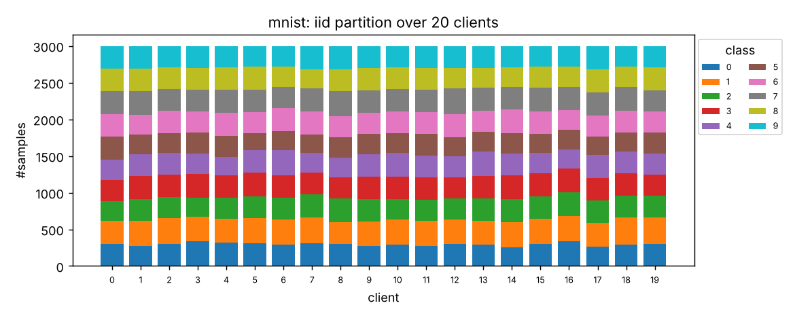
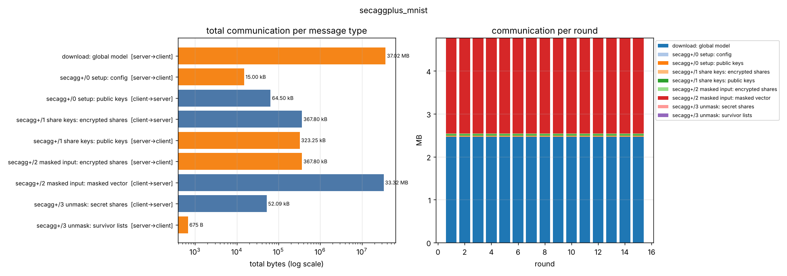
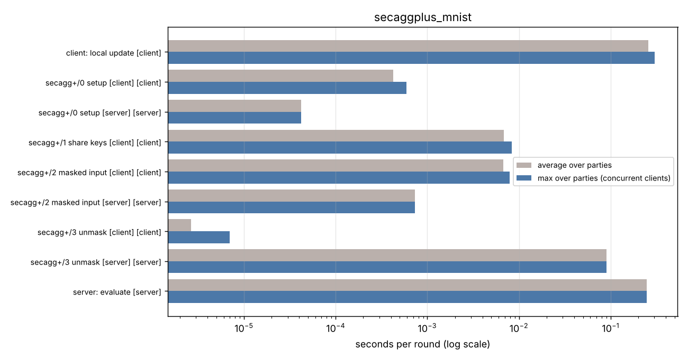

## lightsecagg_mnist

folder: `lightsecagg_mnist/20261109-233041`

<details><summary>report.txt</summary>

```
EXPERIMENT  lightsecagg_mnist
output      demo_results/lightsecagg_mnist/20261109-233041
device      cpu (4 threads)
wall clock  50.85 s (sequential simulation)

FINAL METRICS (last evaluated round)
  round            15
  test_loss        0.0466
  test_acc         0.9844
  survivors        9
  secagg_max_error 0.0000
  elapsed_s        49.9683

protocol: lightsecagg

parameters: LightSecAgg(LightSecAggParams(privacy_threshold=0.3, dropout_tolerance=0.2, clipping_range=1.0, quantization_range=4194304, prime=2147483647))
last round: {'T': 3, 'U': 8, 'N': 10, 'survivors': 9, 'responses': 9, 'piece_len': 12342}
max |secure mean - plain mean| over the last round: 2.91e-07 (quantisation step = 4.8e-07)

COMMUNICATION   (total 210.74 MB over 15 round(s))
label                                          direction       msgs  total      per round  per msg  
----------------------------------------------------------------------------------------------------
download: global model                         server->client   150   37.02 MB    2.47 MB  246.82 kB
lightsecagg/0 keys: public key                 client->server   150   32.25 kB    2.15 kB      215 B
lightsecagg/0 keys: public keys                server->client   150  324.00 kB   21.60 kB    2.16 kB
lightsecagg/0 setup: config                    server->server    15       90 B        6 B        6 B
lightsecagg/1 coded mask pieces (down)         server->client   150   66.69 MB    4.45 MB  444.57 kB
lightsecagg/1 coded mask pieces (up)           client->server   150   66.69 MB    4.45 MB  444.57 kB
lightsecagg/2 masked input                     client->server   135   33.32 MB    2.22 MB  246.82 kB
lightsecagg/3 recovery: aggregated coded mask  client->server   135    6.66 MB  444.31 kB   49.37 kB
lightsecagg/3 recovery: survivor list          server->client   135    1.22 kB       81 B        9 B

COMPUTATION   ('avg/round' = average over parties, 'parallel/round' = max over parties = concurrent clients)
label                                  who     calls  total     per call  avg/round  parallel/round
---------------------------------------------------------------------------------------------------
client: local update                   client    150   29.25 s  195.0 ms   195.0 ms        218.2 ms
lightsecagg/0 keys [client]            client    150   29.2 ms    194 us     194 us          362 us
lightsecagg/0 setup [server]           server     15    3.8 ms    253 us     253 us          253 us
lightsecagg/1 decrypt pieces [client]  client    150  699.3 ms    4.7 ms     4.7 ms          5.3 ms
lightsecagg/1 encode masks [client]    client    150   10.34 s   68.9 ms    68.9 ms         76.8 ms
lightsecagg/2 masked input [client]    client    135  223.6 ms    1.7 ms     1.7 ms          1.9 ms
lightsecagg/2 masked input [server]    server    135   34.9 ms    259 us     2.3 ms          2.3 ms
lightsecagg/3 decode [server]          server     15  868.1 ms   57.9 ms    57.9 ms         57.9 ms
lightsecagg/3 recovery [client]        client    135   62.1 ms    460 us     460 us          538 us
server: evaluate                       server     15    3.17 s  211.2 ms   211.2 ms        211.2 ms

ESTIMATED ROUND LATENCY with concurrent clients (uplink 10 Mbit/s, downlink 50 Mbit/s): compute 574.8 ms + communication 703.8 ms = 1.28 s per round

figures: convergence.png, communication.png, computation.png
```

</details>

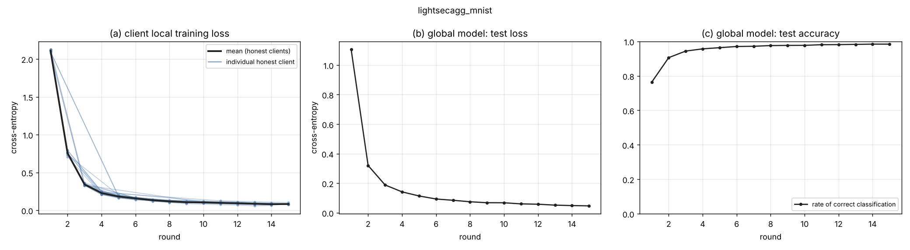

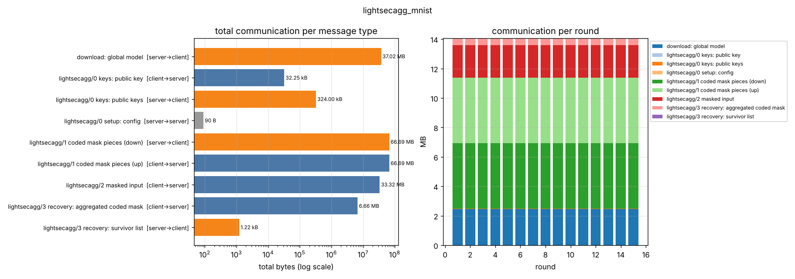
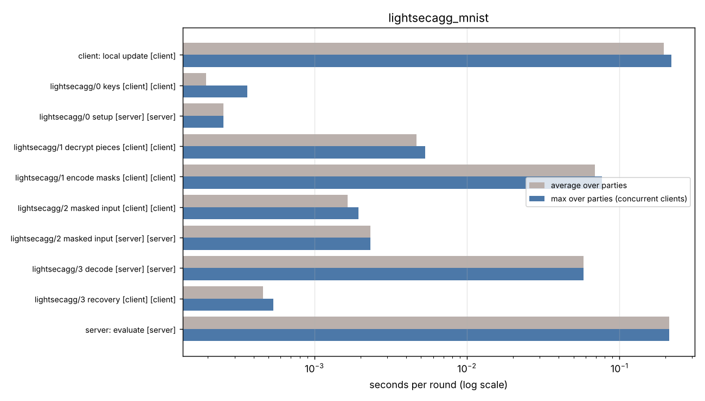

## secagg_dp_mnist

folder: `secagg_dp_mnist/20261104-175626`

<details><summary>report.txt</summary>

```
EXPERIMENT  secagg_dp_mnist
output      demo_results/secagg_dp_mnist/20261104-175626
device      cpu (4 threads)
wall clock  21.85 s (sequential simulation)

FINAL METRICS (last evaluated round)
  round            30
  test_loss        0.4578
  test_acc         0.8773
  survivors        20
  secagg_max_error 0.0000
  epsilon          8.9393
  elapsed_s        20.2155

protocol: secagg+

parameters: SecAggPlus(SecAggPlusParams(num_shares=7, reconstruction_threshold=4, max_weight=1.0, clipping_range=1.0, quantization_range=4194304, modulus_range=4294967296))
last round: {'num_shares': 7, 'threshold': 4, 'U1': 20, 'U2': 20, 'U3': 20, 'U4': 20, 'clipped_fraction': 0.0}
max |secure mean - plain mean| over the last round: 1.58e-07 (quantisation step = 4.8e-07)

COMMUNICATION   (total 44.45 MB over 30 round(s))
label                                     direction       msgs  total      per round  per msg 
----------------------------------------------------------------------------------------------
download: global model                    server->client   600   18.84 MB  628.00 kB  31.40 kB
secagg+/0 setup: config                   server->client   600   60.00 kB    2.00 kB     100 B
secagg+/0 setup: public keys              client->server   600  258.00 kB    8.60 kB     430 B
secagg+/1 share keys: encrypted shares    client->server   600    2.21 MB   73.56 kB   3.68 kB
secagg+/1 share keys: public keys         server->client   600    1.81 MB   60.34 kB   3.02 kB
secagg+/2 masked input: encrypted shares  server->client   600    2.21 MB   73.56 kB   3.68 kB
secagg+/2 masked input: masked vector     client->server   600   18.84 MB  628.08 kB  31.40 kB
secagg+/3 unmask: secret shares           client->server   600  222.60 kB    7.42 kB     371 B
secagg+/3 unmask: survivor lists          server->client   600    4.20 kB      140 B       7 B

COMPUTATION   ('avg/round' = average over parties, 'parallel/round' = max over parties = concurrent clients)
label                            who     calls  total     per call  avg/round  parallel/round
---------------------------------------------------------------------------------------------
client: local update             client    600    2.92 s    4.9 ms     4.9 ms          8.9 ms
secagg+/0 setup [client]         client    600  265.8 ms    443 us     443 us          660 us
secagg+/0 setup [server]         server     30    1.8 ms     61 us      61 us           61 us
secagg+/1 share keys [client]    client    600    6.15 s   10.2 ms    10.2 ms         14.3 ms
secagg+/2 masked input [client]  client    600    2.92 s    4.9 ms     4.9 ms          6.6 ms
secagg+/2 masked input [server]  server    600   12.0 ms     20 us     400 us          400 us
secagg+/3 unmask [client]        client    600    1.7 ms      3 us       3 us            9 us
secagg+/3 unmask [server]        server     30    5.66 s  188.6 ms   188.6 ms        188.6 ms
server: evaluate                 server     30  410.7 ms   13.7 ms    13.7 ms         13.7 ms

ESTIMATED ROUND LATENCY with concurrent clients (uplink 10 Mbit/s, downlink 50 Mbit/s): compute 233.2 ms + communication 34.8 ms = 268.0 ms per round

figures: convergence.png, communication.png, computation.png
```

</details>

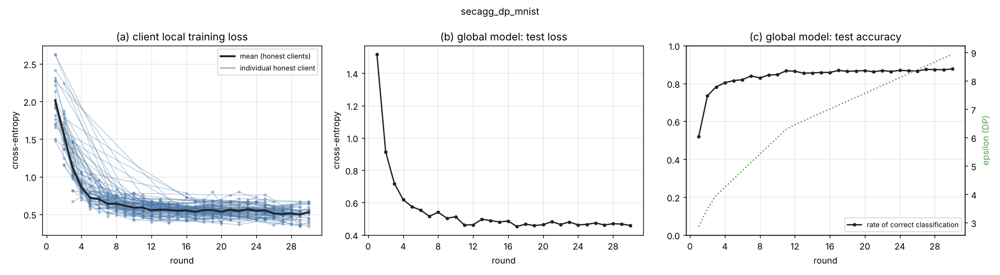
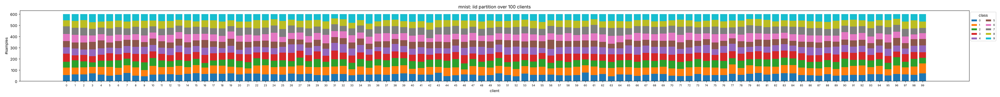
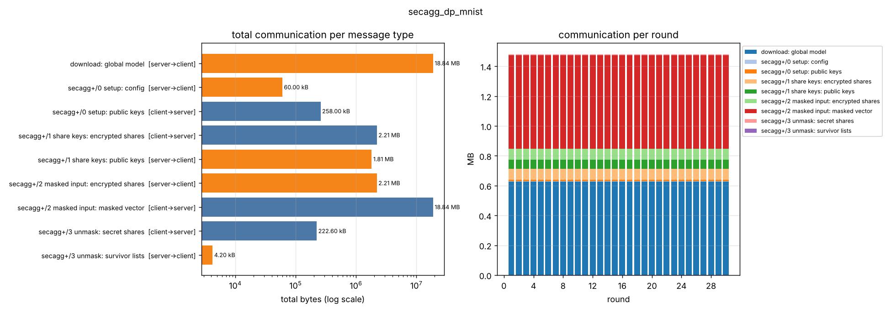
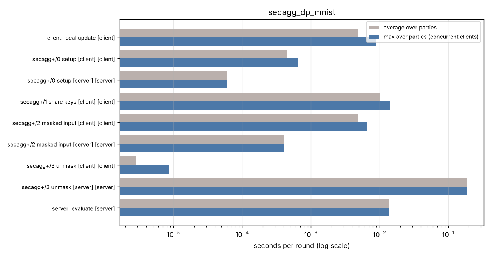

## secagg_scaling

folder: `secagg_scaling/20261109-233132`

<details><summary>report.txt</summary>

```
EXPERIMENT  secagg_scaling
output      demo_results/secagg_scaling/20261109-233132
device      cpu (4 threads)
wall clock  32.87 s (sequential simulation)

rows: 15

SCALING (one aggregation per row)
protocol                                                    n  dropped  upload/client  download/client  client compute  server compute  est. latency  max error
secagg(reconstruction_threshold=0.5)                        5        0       83.15 kB          4.71 kB          9.2 ms         24.9 ms      101.4 ms    2.5e-06
secagg(reconstruction_threshold=0.5)                       10        1       86.75 kB          9.94 kB         17.7 ms        164.0 ms      253.0 ms    2.1e-06
secagg(reconstruction_threshold=0.5)                       20        2       93.69 kB         20.39 kB         56.0 ms          1.05 s        1.19 s    1.6e-06
secagg(reconstruction_threshold=0.5)                       30        3      100.62 kB         30.84 kB        111.5 ms          3.12 s        3.33 s    1.3e-06
secagg(reconstruction_threshold=0.5)                       40        4      107.55 kB         41.29 kB        178.5 ms          6.72 s        7.00 s    1.2e-06
secagg+(num_shares=7, reconstruction_threshold=4)           5        0       83.15 kB          4.71 kB         10.5 ms         27.5 ms      105.3 ms    2.7e-06
secagg+(num_shares=7, reconstruction_threshold=4)          10        1       84.75 kB          6.80 kB         15.4 ms        102.7 ms      187.5 ms    2.0e-06
secagg+(num_shares=7, reconstruction_threshold=4)          20        2       85.03 kB          6.80 kB         13.1 ms        188.4 ms      271.2 ms    1.5e-06
secagg+(num_shares=7, reconstruction_threshold=4)          30        3       85.03 kB          6.80 kB         17.8 ms        263.3 ms      355.1 ms    1.2e-06
secagg+(num_shares=7, reconstruction_threshold=4)          40        4       85.03 kB          6.80 kB         16.4 ms        415.6 ms      502.9 ms    9.7e-07
lightsecagg(privacy_threshold=0.3, dropout_tolerance=0.2)   5        0      280.33 kB        161.20 kB         30.6 ms         15.1 ms      296.0 ms    2.6e-06
lightsecagg(privacy_threshold=0.3, dropout_tolerance=0.2)  10        1      240.48 kB        146.43 kB         32.3 ms         18.8 ms      268.0 ms    1.9e-06
lightsecagg(privacy_threshold=0.3, dropout_tolerance=0.2)  20        2      240.77 kB        156.89 kB         59.7 ms         34.6 ms      313.8 ms    1.5e-06
lightsecagg(privacy_threshold=0.3, dropout_tolerance=0.2)  30        3      241.14 kB        162.09 kB        112.2 ms         49.4 ms      383.0 ms    1.1e-06
lightsecagg(privacy_threshold=0.3, dropout_tolerance=0.2)  40        4      241.35 kB        165.81 kB        131.9 ms         66.3 ms      419.9 ms    9.9e-07

figure: scaling.png


figures:
```

</details>


## privacy_attacks_mnist

folder: `privacy_attacks_mnist/20261111-205419`

<details><summary>report.txt</summary>

```
EXPERIMENT  privacy_attacks_mnist
output      demo_results/privacy_attacks_mnist/20261111-205419
device      cpu (4 threads)
wall clock  33.36 s (sequential simulation)

dp_mode: local
psnr_individual: {'no DP': 79.7970372317785, 'sigma=0.001': 18.678241990059096, 'sigma=0.01': 4.120753505298283, 'sigma=0.1': 3.2838526771383405}
psnr_aggregate: {'no DP': {0: 8.57477223106264, 1: 9.199783911259738, 2: 10.937359367038678, 3: 13.31840132242606, 4: 16.772409467337603, 5: 16.364306775720017, 6: 17.1857912684992, 7: 16.99970728517485, 8: 16.403529412897143, 9: 16.549386970524015}, 'sigma=0.001': {0: 5.252045865014421, 1: 5.7026861249739245, 2: 8.810099610296767, 3: 8.88656060805535, 4: 7.087738964827897, 5: 6.968649805729024, 6: 7.070112327033864, 7: 6.955023774747015, 8: 6.655865065115315, 9: 6.887364534161997}, 'sigma=0.01': {0: 3.590771202391872, 1: 3.9174902471975157, 2: 3.7360222635953164, 3: 3.733429887734273, 4: 3.9662646572911124, 5: 3.9635192534220147, 6: 3.959764669599293, 7: 3.9682994331980637, 8: 3.9219472942381812, 9: 4.0798947795600675}, 'sigma=0.1': {0: 3.137178084492218, 1: 3.5583798279063887, 2: 3.59325905881129, 3: 3.662921880607673, 4: 3.4671424661510746, 5: 3.4863863124520735, 6: 3.321680771490225, 7: 3.4555391537519977, 8: 3.6622775424411778, 9: 3.6114111545933096}}

individual upload: PSNR of the reconstruction vs. the target's private image (> ~25 dB = recognisable)
  no DP          79.8 dB
  sigma=0.001    18.7 dB
  sigma=0.01      4.1 dB
  sigma=0.1       3.3 dB

joint inversion of the aggregate: PSNR of every participant's dummy vs. its own image (dB)
  setting         c0 (4)   c1 (5)   c2 (4)   c3 (5)   c4 (8)   c5 (2)   c6 (0)   c7 (7)   c8 (9)   c9 (1)
  no DP              8.6      9.2     10.9     13.3     16.8     16.4     17.2     17.0     16.4     16.5
  sigma=0.001        5.3      5.7      8.8      8.9      7.1      7.0      7.1      7.0      6.7      6.9
  sigma=0.01         3.6      3.9      3.7      3.7      4.0      4.0      4.0      4.0      3.9      4.1
  sigma=0.1          3.1      3.6      3.6      3.7      3.5      3.5      3.3      3.5      3.7      3.6

figures: gradient_inversion.png, aggregate_all_clients.png

COMMUNICATION   (total 537.04 kB over 1 round(s))
label             direction       msgs  total      per round  per msg 
----------------------------------------------------------------------
upload: gradient  client->server    10  537.04 kB  537.04 kB  53.70 kB

COMPUTATION   ('avg/round' = average over parties, 'parallel/round' = max over parties = concurrent clients)
label                                    who     calls  total    per call  avg/round  parallel/round
----------------------------------------------------------------------------------------------------
client: gradient                         client     10  45.6 ms    4.6 ms     4.6 ms         28.1 ms
server: invert aggregate (no DP)         server      1   4.40 s    4.40 s     4.40 s          4.40 s
server: invert aggregate (sigma=0.001)   server      1   4.44 s    4.44 s     4.44 s          4.44 s
server: invert aggregate (sigma=0.01)    server      1   4.39 s    4.39 s     4.39 s          4.39 s
server: invert aggregate (sigma=0.1)     server      1   4.53 s    4.53 s     4.53 s          4.53 s
server: invert individual (no DP)        server      1   3.04 s    3.04 s     3.04 s          3.04 s
server: invert individual (sigma=0.001)  server      1   3.96 s    3.96 s     3.96 s          3.96 s
server: invert individual (sigma=0.01)   server      1   3.58 s    3.58 s     3.58 s          3.58 s
server: invert individual (sigma=0.1)    server      1   2.38 s    2.38 s     2.38 s          2.38 s

ESTIMATED ROUND LATENCY with concurrent clients (uplink 10 Mbit/s, downlink 50 Mbit/s): compute 30.74 s + communication 43.0 ms = 30.79 s per round

figures: communication.png, computation.png
```

</details>


## sweep_byzantine_mnist

folder: `sweep_byzantine_mnist/20261104-173515`

<details><summary>report.txt</summary>

```
SWEEP sweep_byzantine_mnist  (byzantine.py, base byz_base_mnist.yaml), final test_acc
                                     mean              median              trmean              geomed                krum          multi_krum      cclip(tau=1.0)
none                               0.9186              0.9188              0.9185              0.9186              0.9075              0.9186              0.9187
signflip                           0.9037              0.9058              0.9054              0.9066              0.8921              0.9071              0.9041
ipm(tau=5.0)                       0.0494              0.9061              0.9029              0.9064              0.9069              0.9188              0.8727
alie(tau=1.5)                      0.9174              0.9165              0.9164              0.9178              0.9069              0.9188              0.9174
gaussian(sigma=1.0)                0.1993              0.9183              0.9188              0.9187              0.9069              0.9188              0.9186
minmax                             0.9207              0.9191              0.9197              0.9206              0.9069              0.9194              0.9207
```

</details>


## sweep_byzantine_noniid_mnist

folder: `sweep_byzantine_noniid_mnist/20261104-174352`

<details><summary>report.txt</summary>

```
SWEEP sweep_byzantine_noniid_mnist  (byzantine.py, base byz_base_mnist.yaml), final test_acc
                               mean              median              trmean              geomed                krum          multi_krum      cclip(tau=1.0)
none                         0.8991              0.8467              0.8736              0.8954              0.5298              0.8324              0.8990
signflip                     0.7719              0.4943              0.4765              0.6589              0.2989              0.3145              0.7714
ipm(tau=5.0)                 0.0958              0.4265              0.4666              0.6860              0.5390              0.8476              0.5327
alie(tau=1.5)                0.8875              0.8482              0.8476              0.8839              0.5390              0.8633              0.8875
minmax                       0.8700              0.8185              0.8128              0.8645              0.4691              0.7934              0.8697
minsum                       0.8738              0.8185              0.8191              0.8682              0.5226              0.8277              0.8735
```

</details>


## sweep_byzantine_noniid_nnm_mnist

folder: `sweep_byzantine_noniid_nnm_mnist/20261104-175648`

<details><summary>report.txt</summary>

```
SWEEP sweep_byzantine_noniid_nnm_mnist  (byzantine.py, base byz_base_mnist.yaml), final test_acc
                               mean              median              trmean              geomed                krum          multi_krum      cclip(tau=1.0)
none                         0.8863              0.8738              0.8766              0.8780              0.8151              0.8477              0.8864
signflip                     0.6865              0.5849              0.6085              0.6027              0.5664              0.5874              0.6865
ipm(tau=5.0)                 0.4641              0.8713              0.8713              0.8715              0.8712              0.8713              0.5553
alie(tau=1.5)                0.8806              0.8729              0.8732              0.8727              0.8712              0.8726              0.8803
minmax                       0.8678              0.8710              0.8711              0.8707              0.8709              0.8716              0.8678
minsum                       0.8655              0.8531              0.8605              0.8648              0.8497              0.8619              0.8654
```

</details>


## lightsecagg_mnist_dropouts

folder: `lightsecagg_mnist_dropouts/20261110-015639`

<details><summary>report.txt</summary>

```
EXPERIMENT  lightsecagg_mnist_dropouts
output      demo_results/lightsecagg_mnist_dropouts/20261110-015639
device      cpu (4 threads)
wall clock  61.22 s (sequential simulation)

FINAL METRICS (last evaluated round)
  round            15
  test_loss        0.0459
  test_acc         0.9849
  survivors        9
  secagg_max_error 0.0000
  recovery_responses 7
  elapsed_s        60.2302

protocol: lightsecagg

parameters: LightSecAgg(LightSecAggParams(privacy_threshold=0.3, dropout_tolerance=0.3, clipping_range=1.0, quantization_range=4194304, prime=2147483647))
last round: {'T': 3, 'U': 7, 'N': 10, 'survivors': 9, 'responses': 7, 'piece_len': 15427}
max |secure mean - plain mean| over the last round: 2.81e-07 (quantisation step = 4.8e-07)

COMMUNICATION   (total 243.87 MB over 15 round(s))
label                                          direction       msgs  total      per round  per msg  
----------------------------------------------------------------------------------------------------
download: global model                         server->client   150   37.02 MB    2.47 MB  246.82 kB
lightsecagg/0 keys: public key                 client->server   150   32.25 kB    2.15 kB      215 B
lightsecagg/0 keys: public keys                server->client   150  324.00 kB   21.60 kB    2.16 kB
lightsecagg/0 setup: config                    server->server    15       90 B        6 B        6 B
lightsecagg/1 coded mask pieces (down)         server->client   150   83.34 MB    5.56 MB  555.63 kB
lightsecagg/1 coded mask pieces (up)           client->server   150   83.34 MB    5.56 MB  555.63 kB
lightsecagg/2 masked input                     client->server   135   33.32 MB    2.22 MB  246.82 kB
lightsecagg/3 recovery: aggregated coded mask  client->server   105    6.48 MB  431.96 kB   61.71 kB
lightsecagg/3 recovery: survivor list          server->client   135    1.22 kB       81 B        9 B

COMPUTATION   ('avg/round' = average over parties, 'parallel/round' = max over parties = concurrent clients)
label                                  who     calls  total     per call  avg/round  parallel/round
---------------------------------------------------------------------------------------------------
client: local update                   client    150   39.88 s  265.9 ms   265.9 ms        305.0 ms
lightsecagg/0 keys [client]            client    150   32.4 ms    216 us     216 us          464 us
lightsecagg/0 setup [server]           server     15    6.3 ms    422 us     422 us          422 us
lightsecagg/1 decrypt pieces [client]  client    150  720.2 ms    4.8 ms     4.8 ms          5.2 ms
lightsecagg/1 encode masks [client]    client    150   11.52 s   76.8 ms    76.8 ms         84.7 ms
lightsecagg/2 masked input [client]    client    135  245.6 ms    1.8 ms     1.8 ms          2.2 ms
lightsecagg/2 masked input [server]    server    135   37.6 ms    278 us     2.5 ms          2.5 ms
lightsecagg/3 decode [server]          server     15  844.6 ms   56.3 ms    56.3 ms         56.3 ms
lightsecagg/3 recovery [client]        client    105   66.6 ms    634 us     634 us          832 us
server: evaluate                       server     15    4.09 s  272.4 ms   272.4 ms        272.4 ms

ESTIMATED ROUND LATENCY with concurrent clients (uplink 10 Mbit/s, downlink 50 Mbit/s): compute 730.1 ms + communication 820.2 ms = 1.55 s per round

figures: convergence.png, communication.png, computation.png
```

</details>


## privacy_attacks_mnist_central

folder: `privacy_attacks_mnist_central/20261111-205452`

<details><summary>report.txt</summary>

```
EXPERIMENT  privacy_attacks_mnist_central
output      demo_results/privacy_attacks_mnist_central/20261111-205452
device      cpu (4 threads)
wall clock  32.44 s (sequential simulation)

dp_mode: central
psnr_individual: {'no DP': 79.7970372317785, 'sigma=0.001': 79.7970372317785, 'sigma=0.01': 79.7970372317785, 'sigma=0.1': 79.7970372317785}
psnr_aggregate: {'no DP': {0: 8.57477223106264, 1: 9.199783911259738, 2: 10.937359367038678, 3: 13.31840132242606, 4: 16.772409467337603, 5: 16.364306775720017, 6: 17.1857912684992, 7: 16.99970728517485, 8: 16.403529412897143, 9: 16.549386970524015}, 'sigma=0.001': {0: 8.424870211961318, 1: 8.225394029857597, 2: 8.505790706897143, 3: 9.977386041184795, 4: 10.782708336776828, 5: 11.330030940401375, 6: 11.889990078797862, 7: 11.143190522150963, 8: 9.923247529611904, 9: 11.303013540008678}, 'sigma=0.01': {0: 3.497183376624535, 1: 4.225134149155527, 2: 5.3787131215184205, 3: 3.7718277143202905, 4: 4.69215529533032, 5: 4.453837708302454, 6: 4.46299466410039, 7: 4.644484993794439, 8: 4.139075182120585, 9: 4.754657447892638}, 'sigma=0.1': {0: 3.6651404947020816, 1: 3.9133797136368815, 2: 3.3553137691287587, 3: 3.4855068518796353, 4: 3.5181265191562847, 5: 4.047523680059445, 6: 3.517026794697907, 7: 3.8260304215815495, 8: 3.780946489260846, 9: 3.09366421363209}}

individual upload: PSNR of the reconstruction vs. the target's private image (> ~25 dB = recognisable)
  no DP          79.8 dB
  sigma=0.001    79.8 dB
  sigma=0.01     79.8 dB
  sigma=0.1      79.8 dB

joint inversion of the aggregate: PSNR of every participant's dummy vs. its own image (dB)
  setting         c0 (4)   c1 (5)   c2 (4)   c3 (5)   c4 (8)   c5 (2)   c6 (0)   c7 (7)   c8 (9)   c9 (1)
  no DP              8.6      9.2     10.9     13.3     16.8     16.4     17.2     17.0     16.4     16.5
  sigma=0.001        8.4      8.2      8.5     10.0     10.8     11.3     11.9     11.1      9.9     11.3
  sigma=0.01         3.5      4.2      5.4      3.8      4.7      4.5      4.5      4.6      4.1      4.8
  sigma=0.1          3.7      3.9      3.4      3.5      3.5      4.0      3.5      3.8      3.8      3.1

figures: gradient_inversion.png, aggregate_all_clients.png

COMMUNICATION   (total 537.04 kB over 1 round(s))
label             direction       msgs  total      per round  per msg 
----------------------------------------------------------------------
upload: gradient  client->server    10  537.04 kB  537.04 kB  53.70 kB

COMPUTATION   ('avg/round' = average over parties, 'parallel/round' = max over parties = concurrent clients)
label                                    who     calls  total    per call  avg/round  parallel/round
----------------------------------------------------------------------------------------------------
client: gradient                         client     10  15.0 ms    1.5 ms     1.5 ms          2.1 ms
server: invert aggregate (no DP)         server      1   4.27 s    4.27 s     4.27 s          4.27 s
server: invert aggregate (sigma=0.001)   server      1   4.16 s    4.16 s     4.16 s          4.16 s
server: invert aggregate (sigma=0.01)    server      1   4.07 s    4.07 s     4.07 s          4.07 s
server: invert aggregate (sigma=0.1)     server      1   4.59 s    4.59 s     4.59 s          4.59 s
server: invert individual (no DP)        server      1   3.27 s    3.27 s     3.27 s          3.27 s
server: invert individual (sigma=0.001)  server      1   3.34 s    3.34 s     3.34 s          3.34 s
server: invert individual (sigma=0.01)   server      1   2.94 s    2.94 s     2.94 s          2.94 s
server: invert individual (sigma=0.1)    server      1   3.92 s    3.92 s     3.92 s          3.92 s

ESTIMATED ROUND LATENCY with concurrent clients (uplink 10 Mbit/s, downlink 50 Mbit/s): compute 30.55 s + communication 43.0 ms = 30.59 s per round

figures: communication.png, computation.png
```

</details>


